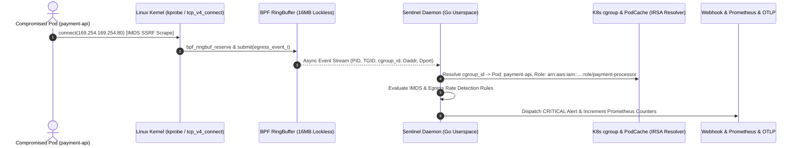

<h1 align="center">🛡️ ebpf-cloud-sentinel</h1>
<p align="center">
  <b>High-Performance, Zero-Overhead eBPF Egress Security &amp; IRSA Sensor for Kubernetes Workloads</b>
</p>

<p align="center">
  <a href="https://github.com/ekrmcakir/ebpf-cloud-sentinel/actions/workflows/ci.yml">
    
  </a>
  <a href="https://github.com/ekrmcakir/ebpf-cloud-sentinel/releases">
    
  </a>
  
  
  
  
  
  
</p>

---

## 🎯 Overview

**ebpf-cloud-sentinel** is a cloud-native security sensor deployed as a Kubernetes DaemonSet. Operating directly in Linux kernel space via **eBPF (Extended Berkeley Packet Filter)**, it intercepts container socket connections asynchronously with zero proxy latency.

By correlating low-level kernel cgroup IDs to **Kubernetes Pods, Namespaces, and AWS IAM Roles for Service Accounts (IRSA)**, Sentinel provides real-time detection and mitigation against **IMDSv2 credential scraping (SSRF)**, rogue cloud storage exfiltration, and anomalous egress spikes.

---

## 💡 Why ebpf-cloud-sentinel?

Traditional perimeter defenses and userspace proxies struggle to provide granular identity context without degrading network performance:

| Capability | ebpf-cloud-sentinel | Service Mesh (Istio / Envoy) | K8s NetworkPolicy (iptables/IPVS) | CloudWatch VPC Flow Logs |
| :--- | :---: | :---: | :---: | :---: |
| **Latency Overhead** | **~0 µs (Kernel async)** | High (Userspace proxy hop) | Low (iptables evaluation) | None (Out-of-band) |
| **IMDSv2 SSRF Detection** | ** Instant (<1ms)** | ⚠️ Difficult / Port-only | ⚠️ Raw IP block only | ❌ Delayed (10-15 min) |
| **Pod & IRSA Identity Context** | ** Yes (cgroup -> Pod & IAM Role)** | ⚠️ Pod only (no AWS IAM Role) | ❌ Raw IP only | ❌ Node / ENI level only |
| **Sidecar Required?** | ** No (Single Node DaemonSet)** | ❌ Yes (Per-pod resource tax) | No | No |
| **Memory Footprint** | **~15MB resident** | ~100MB+ per container | Minimal | N/A |

---

## 🏗️ Architecture & Data Flow



---

## ⚡ Key Capabilities

1. **Kernel-Level IMDSv2 SSRF Shield:** Identifies unauthorized connections to `169.254.169.254` and generates `CRITICAL` alerts with immediate AWS hop-limit mitigation advice.
2. **Context Enrichment via cgroups:** Translates kernel cgroup hashes directly to Kubernetes Pod Name, Namespace, Service Account, and associated `eks.amazonaws.com/role-arn`.
3. **CIDR-Based Cloud IP Classification:** Accurately classifies egress traffic to AWS S3, STS, and Kubernetes API servers using verified subnets instead of loose heuristics.
4. **Anomalous Rate Detection:** Evaluates connection bursts across rolling windows to flag runaway egress loops and exfiltration attempts.
5. **Production Telemetry:** Out-of-the-box Prometheus `/metrics` endpoint with cloud service breakdown and OpenTelemetry (OTLP) log formatting.

---

## 📊 Live Telemetry & Alert Showcase

### Structured Security Alert (`CRITICAL`)
When an attacker inside a container attempts to scrape AWS credentials:

```json
{
  "id": "alert-imds-1700668800000000000",
  "timestamp": "2026-11-22T15:50:30Z",
  "severity": "CRITICAL",
  "title": "AWS IMDSv2 Metadata Access Attempt",
  "description": "Suspicious connection to 169.254.169.254 from pod production/payment-api-6b79d (command: curl)",
  "rule_name": "sec-rule-imds-ssrf-block",
  "mitigation": "Configure AWS IMDS Hop Limit = 1 and restrict via K8s NetworkPolicy",
  "event": {
    "comm": "curl",
    "source_ip": "10.244.1.80",
    "dest_ip": "169.254.169.254",
    "source_port": 49152,
    "dest_port": 80,
    "protocol": "TCP",
    "cloud_service": "AWS_IMDS",
    "pod": {
      "pod_name": "payment-api-6b79d",
      "namespace": "production",
      "service_account": "payment-sa",
      "iam_role_arn": "arn:aws:iam::123456789012:role/payment-processor-role"
    }
  }
}
```

### Prometheus Metrics Exposition (`/metrics`)
```promql
# HELP ebpf_sentinel_egress_events_total Total number of eBPF monitored egress events
# TYPE ebpf_sentinel_egress_events_total counter
ebpf_sentinel_egress_events_total 12840

# HELP ebpf_sentinel_imds_queries_total Total number of AWS IMDS egress attempts
# TYPE ebpf_sentinel_imds_queries_total counter
ebpf_sentinel_imds_queries_total 1

# HELP ebpf_sentinel_security_alerts_total Total number of generated security alerts
# TYPE ebpf_sentinel_security_alerts_total counter
ebpf_sentinel_security_alerts_total 1

# HELP ebpf_sentinel_service_events_total Total egress events grouped by destination cloud service
# TYPE ebpf_sentinel_service_events_total counter
ebpf_sentinel_service_events_total{service="AWS_S3"} 8940
ebpf_sentinel_service_events_total{service="AWS_STS"} 1420
ebpf_sentinel_service_events_total{service="AWS_IMDS"} 1
```

---

## 🚀 Quick Start

### 1. Build & Run Locally
The built-in mock driver enables full development on macOS and non-privileged Linux environments:

```bash
git clone https://github.com/ekrmcakir/ebpf-cloud-sentinel.git
cd ebpf-cloud-sentinel

# Build all binaries
make build

# Start daemon in mock simulation mode
./bin/ebpf-cloud-sentinel --mock --port 9091
```

### 2. Simulate Attack Scenarios
Use the bundled `attack-simulator` CLI to test security detection rules:

```bash
# Scenario 1: AWS IMDS SSRF token scraping
./bin/attack-simulator --attack imds-ssrf --count 5

# Scenario 2: Anomalous AWS S3 egress data exfiltration
./bin/attack-simulator --attack s3-exfiltration --count 10

# Scenario 3: High-frequency rate burst
./bin/attack-simulator --attack rate-burst --count 25
```

### 3. Deploy to Kubernetes via Helm
```bash
# Add RBAC and DaemonSet via Helm
helm install ebpf-cloud-sentinel ./deploy/helm -n kube-system
```

---

## ⚙️ Configuration Reference

Sentinel reads its runtime configuration via environment variables:

| Variable | Type | Default | Description |
| :--- | :--- | :--- | :--- |
| `SENTINEL_METRICS_PORT` | `int` | `9091` | Port for HTTP Prometheus metrics & `/healthz` |
| `SENTINEL_MOCK_DRIVER` | `bool` | `false` | Enable cross-platform mock driver for dev/testing |
| `SENTINEL_WEBHOOK_URL` | `string` | `""` | Webhook URL for forwarding alerts (SIEM / Slack) |
| `SENTINEL_OTLP_ENDPOINT` | `string` | `"localhost:4317"` | OpenTelemetry Collector endpoint |
| `SENTINEL_RATE_LIMIT` | `int` | `100` | Outbound connection threshold per 60s window |
| `SENTINEL_LOG_LEVEL` | `string` | `"INFO"` | Log verbosity (`INFO`, `DEBUG`) |

---

## 🧪 Testing & Verification

Sentinel maintains strict unit, race-condition, and end-to-end integration test coverage:

```bash
# Run lint, race detector, and code coverage
make all

# View package-by-package coverage report
make coverage
```

Every push and pull request is automatically verified via **GitHub Actions** ([`.github/workflows/ci.yml`](.github/workflows/ci.yml)) testing:
* Static analysis (`go vet ./...`)
* Concurrency race detector (`go test -v -race`)
* Multi-stage container compilation (`docker build`)

---

## 📈 Monitoring & Dashboards

A production-ready Grafana dashboard is located in [`docs/grafana-dashboard.json`](docs/grafana-dashboard.json), featuring:
* Real-time egress rate per Kubernetes namespace
* IMDSv2 credential scrape violation alerts
* AWS Cloud Service distribution pie chart
* Top egress talkers by Pod and Command

---

## 📦 Directory Structure

```text
ebpf-cloud-sentinel/
├── bpf/                # Kernel-space C eBPF probes, ring buffer map & headers
├── cmd/
│   ├── sentinel/       # Main Go DaemonSet entrypoint
│   └── simulator/      # Attack simulation CLI (IMDS SSRF, S3 exfil, rate burst)
├── pkg/
│   ├── ebpf/           # Ring buffer reader, mock driver, and event pool
│   ├── models/         # Egress events, security alerts, and Pod context schemas
│   ├── engine/         # CIDR cloud range classifier (AWS S3, STS, Kube API)
│   ├── enricher/       # Linux cgroup parser, Pod cache, and AWS IRSA resolver
│   ├── detector/       # IMDS SSRF and high-frequency rate anomaly detectors
│   ├── telemetry/      # Prometheus HTTP exporter and OpenTelemetry log formatter
│   ├── alerting/       # Non-blocking webhook alert dispatcher with backpressure
│   └── config/         # Environment configuration loader
├── deploy/
│   ├── helm/           # Production Helm chart and values
│   └── k8s/            # Kubernetes ClusterRole, ServiceAccount, and DaemonSet RBAC
├── docs/               # Architecture, telemetry spec, runbook, and Grafana dashboard
├── test/e2e/           # End-to-end simulation test suite
├── Dockerfile          # Multi-stage minimal runtime container
└── Makefile            # Developer workflow automation
```

---

## 📜 License

Licensed under the [Apache License, Version 2.0](LICENSE).
